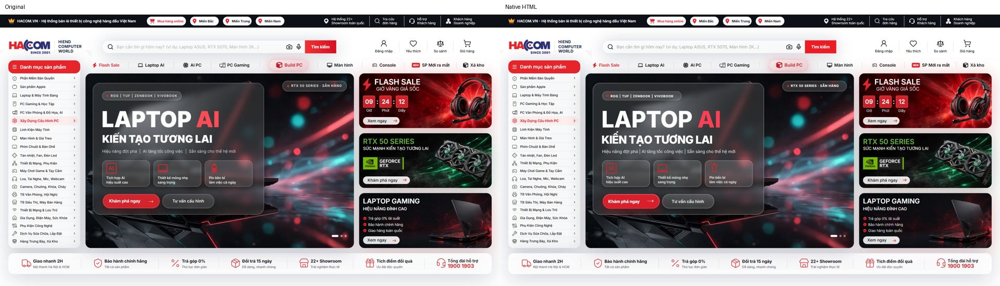
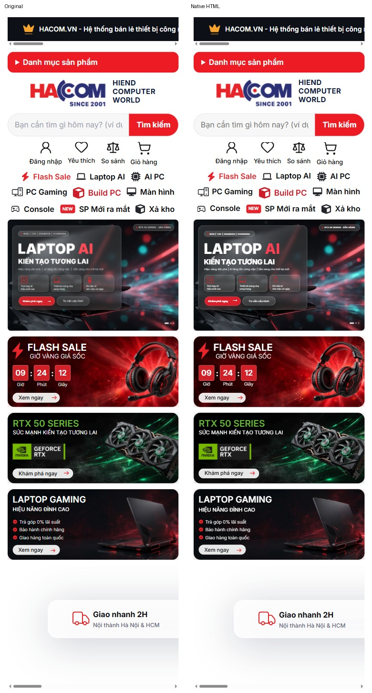

# Hiệu chỉnh header và banner thành HTML — 07/11/2026

Đã hoàn thiện phần header, menu, banner chính, ba banner phụ và chính sách trong ảnh người dùng. Bản gốc được giữ nguyên. Không xác nhận trùng pixel 100%; các khác biệt đo được được công bố dưới đây.

## Nội dung đã sửa

- Chữ trong PNG banner chính đã trở thành HTML hiển thị: nhãn ROG/TUF/Zenbook/Vivobook, tình trạng RTX, tiêu đề LAPTOP AI, tagline, mô tả, ba lợi ích và nút tư vấn. Tiêu đề dùng H2, lợi ích dùng ul/li; hai CTA chứa chính nhãn hiển thị.
- Header và danh mục dùng button chứa chữ thay cho đoạn chữ và nút phủ tách rời; bỏ cả hai nhóm overlay cũ. Điều hướng có nav và danh sách. Ba banner phụ dùng H3 và nút HTML. Tìm kiếm dùng placeholder và nút submit thực trong form.
- Ảnh nền ba banner phụ vốn không có chữ; giữ nguyên các ảnh này. Banner chính không có nền sạch tương đương trong tài nguyên đã khảo sát. Đã loại bỏ chữ và icon khỏi PNG bằng phục hồi từ vùng ảnh lân cận; giữ phần laptop, ánh sáng và nền kính. HTML/CSS dựng lại chữ, icon AI/laptop/pin, viền kính, nút và điều khiển dấu slide.
- Không dùng lại banner còn chữ rồi phủ HTML trùng lên. Logo HACOM/NVIDIA được giữ dưới dạng đồ họa theo phạm vi cho phép. Đã kiểm kê thủ công chữ trong ảnh nguồn và đưa danh sách vào kiểm tra tự động, khắc phục điểm thiếu của audit SVG trước đó.
- Bộ sinh gọi normalize-header.py; build tiếp theo giữ các thành phần mới. Trang triển khai vẫn chỉ cần HTML/CSS/JS và assets, không yêu cầu framework hoặc build.

## Kiểm thử thực tế

Chrome DevTools MCP chạy qua managed launcher, profile chuyên dụng; chỉ thao tác tab của tác vụ. Kết nối cũ không hoạt động đã được khôi phục qua launcher. Ảnh chụp được lấy trực tiếp từ MCP; không dùng browser automation thay thế.

| Viewport | Chiều cao toàn trang | Section lệch >0,1px | Tràn ngang |
|---|---:|---:|---:|
| 360 | 62310 | 0 | 0 |
| 390 | 62132 | 0 | 0 |
| 768 | 45130 | 0 | 0 |
| 1023 | 10734 | 0 | 0 |
| 1024 | 10742 | 0 | 0 |
| 1280 | 13428 | 0 | 0 |
| 1440 | 15107 | 0 | 0 |
| 1920 | 20142 | 0 | 0 |
| 2560 | 20142 | 0 | 0 |
| 3440 | 20142 | 0 | 0 |

Chuỗi resize 1920 → 390 → 768 → 1024 → 360 → 1920 cũng khớp với bản gốc ở cả 22 section. Chiều cao 768px trong chuỗi resize là 45.142px; khi tải mới ở 768px là 45.130px, phù hợp hành vi reflow của bản gốc.

Đã kiểm tra yêu thích bật/tắt, giỏ hàng, CTA, chọn dấu carousel, tìm kiếm, menu, bộ lọc, carousel sản phẩm và đăng ký email/điện thoại hợp lệ/không hợp lệ cùng consent. Chuột thật qua MCP click, phím Space, Enter và Escape đều có bằng chứng trong các file kết quả. Không tạo giao dịch hoặc kết nối dịch vụ bên ngoài.

Bản kiểm tra qua HTTP cùng origin với CSP script-src 'none' vẫn có tiêu đề và lợi ích banner đang hiển thị, một H1 và đủ 22 section. Console xác nhận index2.js bị CSP chặn, không có lỗi tải font trong phép kiểm tra này.

## SEO, HTML và accessibility

HTML5 parser không báo lỗi; không có ID trùng, ảnh thiếu alt, nút thiếu tên truy cập, liên kết # hoặc script ngoài. Còn đúng một H1; source có 25 H2 (bao gồm các biến thể responsive) và 51 H3. Không thêm heading ẩn để thay thế chữ trong ảnh.

| Thiết bị | SEO | Best Practices | Accessibility |
|---|---:|---:|---:|
| Desktop | 100 | 100 | 92 |
| Mobile | 100 | 100 | 92 |

Hai nhóm cảnh báo còn lại là tương phản và vùng bấm. Chữ trắng trên đỏ #ed1c24 đạt khoảng 4,38:1, thấp hơn yêu cầu 4,5:1 cho chữ nhỏ; dấu slide và các hàng khi co nhỏ có mục tiêu bấm sát nhau. Đã giữ thiết kế hiển thị theo yêu cầu; không coi điểm SEO là bằng chứng index trên production. Canonical/OG URL/robots/schema vẫn cần dữ liệu triển khai thực tế như báo cáo nền. Không truy cập GA, GTM hoặc Search Console.

## Bằng chứng thị giác

Ảnh trước/sau, overlay và diff ở reference/header-native-visual/. Mobile 360/390/768 được chụp đủ chiều cao header; các viewport khác được cắt theo chiều cao header khi tính diff. Cùng Chrome, DPR 1, chờ font và ảnh sẵn sàng.

| Viewport | Sai số trung bình /255 | Pixel có sai khác độ sáng >16 |
|---|---:|---:|
| 360 | 3.722 | 4.87% |
| 390 | 3.981 | 5.22% |
| 768 | 3.579 | 4.67% |
| 1023 | 3.966 | 5.43% |
| 1024 | 3.845 | 5.33% |
| 1280 | 3.754 | 4.59% |
| 1440 | 3.751 | 4.66% |
| 1920 | 3.564 | 4.21% |
| 2560 | 2.669 | 3.16% |
| 3440 | 1.987 | 2.35% |

Sai lệch tập trung ở raster chữ được thay bằng font HTML, viền icon/nút và texture kính sau khi bỏ chữ khỏi PNG. Texture đã phục hồi không thể được coi là nền gốc không chữ chính xác. Không xác nhận giống 100% bằng cảm nhận hoặc suy diễn từ việc khớp chiều cao.

## Dung lượng và bản gốc

Mã HTML/CSS/JS hiện tại: 541,961 B so với 1,542,084 B của bản gốc, giảm 64.9%. Đồ họa được trang tham chiếu: 34,528,433 B so với 130,815,463 B, giảm 73.6%. Không suy diễn mức giảm này thành tốc độ render; số đo tải trong báo cáo nền thuộc bản trước hiệu chỉnh header.

SHA-256 index.html không đổi: 4a4aebb09a52f89a9d0dc04fa0a8d6e63b412982d9da9cb285b90d0df7d395ce.

Bằng chứng máy đọc: reference/header-native-audit.json, header-matrix-results.json, header-final-results.json, header-raster-proof-results.json, header-breakpoint-results.json, header-interaction-results.json, header-full-interaction-results.json, header-mouse-results.json, header-keyboard-results.json và header-nojs-final-results.json. Lighthouse HTML/JSON ở reference/header-native-lighthouse/.
